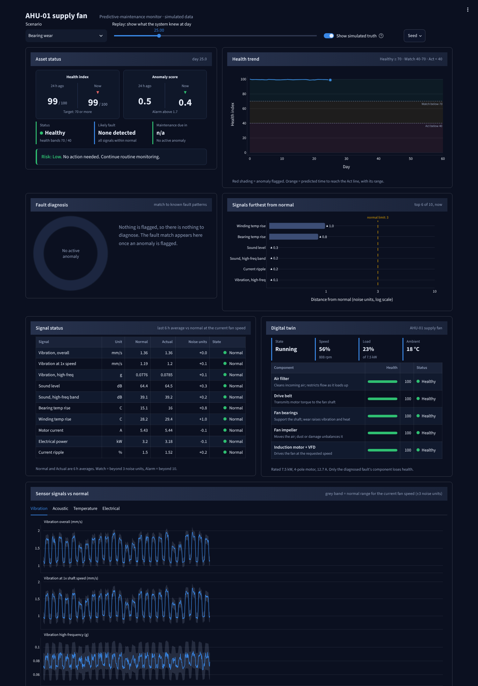
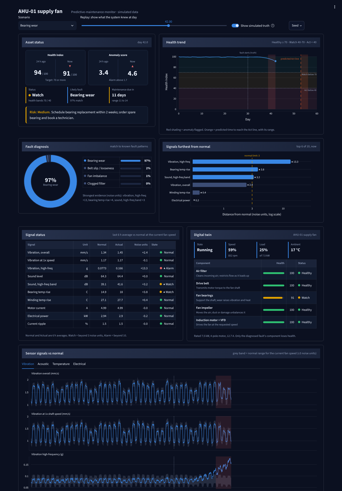
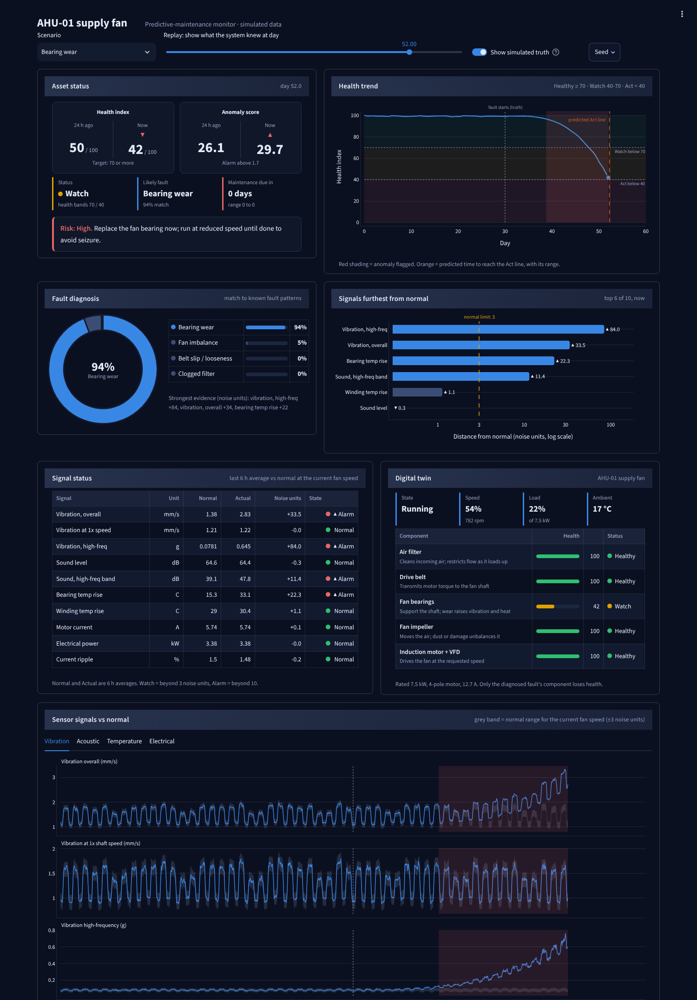

# AssetPulse: predictive-maintenance proof of concept

A small, explainable predictive-maintenance pipeline for one asset: an **AHU supply fan** (belt-driven
centrifugal fan, 7.5 kW induction motor, VFD). It simulates vibration, sound, temperature and electrical
signals, injects four progressive faults, and shows health, anomalies, the likely fault, days to maintenance
and a recommended action in a Streamlit dashboard.

> All data is **synthetic**. Results show the approach and that the pipeline works. They say nothing about
> accuracy on a real machine.

## Demo: the end-to-end workflow in screenshots

One simulated bearing failure, replayed at three points in time. The dashboard only uses data up to the chosen day,
so each screenshot is "what the system knew then". Dotted lines (simulated truth) are shown for the reader only; the analytics never sees them.

| Day 25: normal | Day 42: early warning | Day 52: act now |
| --- | --- | --- |
| [](docs/screenshots/01_bearing_normal.png) | [](docs/screenshots/02_bearing_early_warning.png) | [](docs/screenshots/03_bearing_act_now.png) |

**What happens, step by step**

1. **Machine and sensors.** The simulated AHU fan reports 10 signals every 10 minutes (vibration, sound, temperatures, current, power, ripple).
2. **Digital twin.** The twin holds the fan's spec, operating state and a health value per component (Air filter, Drive belt, Fan bearings, Fan impeller, Motor).
3. **Day 25, normal.** Every signal sits inside its normal band for the current fan speed: Healthy, no action.
4. **Day 42, early warning.** High-frequency vibration is 13 noise units above normal and bearing temperature and high-frequency sound have started to move. The pattern matches *bearing wear* at 97%, health is 91 (Watch), and the system says: *maintenance due in about 11 days (range 11-14), risk Medium, schedule bearing replacement within 2 weeks.* The overall vibration is still only 2.4 units out, so a simple vibration alarm would not have fired yet.
5. **Day 52, act now.** Vibration is 84 units out and still rising, health has fallen to 42, risk is High: *replace the bearing now and run at reduced speed.* The simulated failure is on day 56.

Other scenarios (same pipeline, different fault fingerprints):
[imbalance](docs/screenshots/04_imbalance.png) ·
[belt slip](docs/screenshots/05_belt_slip.png) ·
[clogged filter](docs/screenshots/06_clogged_filter.png) ·
[healthy, no false alarm](docs/screenshots/07_healthy.png)

## How to read the dashboard

| Panel | Question it answers |
| --- | --- |
| Asset status | Is it OK? Health index and anomaly score now vs 24 h ago, likely fault, days to maintenance, risk and the recommended action |
| Health trend | How fast is it declining? Bands (Healthy / Watch / Act) and the predicted time to reach Act, with a range |
| Fault diagnosis | What is wrong? Match of the current pattern to each known fault, with the strongest evidence |
| Signals furthest from normal | Which sensors moved most? Distance from normal in noise units (log scale; 3 = outside normal) |
| Signal status | Expected vs actual value for every signal at the current fan speed |
| Digital twin | Which component is affected? State, speed, load, ambient and per-component health |
| Sensor signals vs normal | The raw evidence: each signal against its normal band, with anomaly periods shaded |

Deep links work too, for example `http://localhost:8501/?scenario=filter&day=50`.

## Run it

```bash
# Python 3.10 or newer
python3 -m venv .venv && . .venv/bin/activate      # Windows: .venv\Scripts\activate
pip install -r requirements.txt
streamlit run app.py          # dashboard, http://localhost:8501
python scripts/validate.py    # five 60-day scenarios vs. the success criteria
python -m pytest -q           # 31 unit tests
```

## What is in it

| Module | Job |
| --- | --- |
| `assetpulse/config.py` | Every tunable number: scenarios, fault fingerprints, thresholds, actions |
| `assetpulse/simulator.py` | Healthy baseline + bearing wear, imbalance, belt slip, clogged filter (ground truth included) |
| `assetpulse/twin.py` | The asset: rated spec, components, operating state, per-component health |
| `assetpulse/analytics.py` | Baseline, z-scores, anomaly score, diagnosis, health index, days remaining, risk, advice |
| `assetpulse/pipeline.py` | Runs a scenario and answers "what is the state at reading N?" |
| `assetpulse/viz.py`, `app.py`, `.streamlit/config.toml` | Dark-theme panel dashboard: status tiles, health trend, fault donut, deviation bars, signal table, twin, signal charts |
| `scripts/validate.py`, `calibrate.py` | Success-criteria check; derives the failure-level numbers in config |

## How the analytics work

1. **Features**: 10 numbers per reading (vibration overall / 1x / high-frequency, sound level / high-frequency band,
   bearing and winding temperature rise over ambient, current, power, current ripple).
2. **Baseline**: for each feature, a smooth function of fan speed learned from the first 14 healthy days
   (cubic fit) plus a robust noise scale (MAD). Speed matters: power rises with speed cubed, so "normal" at 55% and 100% speed differ.
3. **Anomaly**: z-score per feature, smoothed over 6 h, combined as a root-mean-square. A flag needs the score above a
   threshold learned from the healthy period for 6 hours in a row, and stays on until it falls well below.
4. **Diagnosis**: cosine similarity between the observed deviation pattern and each fault's fingerprint
   (e.g. imbalance = vibration at 1x; clogged filter = power and current *down*). Below a minimum similarity the answer is "unclassified".
   Confidence and the supporting signals are shown.
5. **Health index** 0-100: how far along the diagnosed fault's fingerprint the signals have moved, relative to
   where they sit at failure. Healthy ≥ 70, Watch 40-70, Act < 40.
6. **Days to maintenance**: an accelerating power-law curve is fitted to the decline since the alarm and extrapolated to
   the Act line; the range comes from all fits nearly as good as the best.
7. **Risk and action**: risk from days remaining (>14 Low, 3-14 Medium, <3 High), then a (fault, risk) lookup.

## Validation results (seed 7; 20 seeds in brackets)

| Scenario | First alarm | Lead before failure | Diagnosis | Days-to-Act error at midpoint |
| --- | --- | --- | --- | --- |
| Healthy | none | n/a | n/a | 0 false alarms (20/20 seeds) |
| Bearing wear | day 38.8 | 17 d | correct (20/20) | 3% (20/20 within 30%) |
| Imbalance | day 39.7 | 18 d | correct (20/20) | 31% (11/20 within 30%) |
| Belt slip | day 28.3 | 24 d | correct (20/20) | 5% (20/20 within 30%) |
| Clogged filter | day 28.6 | 29 d | correct (20/20) | 9% (8/20 within 30%) |

Detection, lead time (needed ≥ 5 days) and diagnosis meet the criteria on every run. **The days-remaining
accuracy criterion is only partly met**: bearing and belt are accurate, imbalance is biased about 30% pessimistic
(predicts maintenance earlier than needed), and the clogged filter, whose signal is weak next to its noise, is
noisy (median error across all runs 9%, worst case about 190%). The quoted range contains the true value in
roughly 84% of runs.

Notes on how the PRD criteria were made testable:
- "True" days remaining is when the 24 h-smoothed health index actually crossed the Act line in that run,
  judged at the midpoint between the first alarm and that crossing.
- The failure-level numbers (`FAIL_Z`) and the power-law fit family were tuned on this simulator, so
  these results flatter the method. Real use would need failure data or alarm limits to set them.

## Limits

One fault at a time; faults and noise are simulated by the same author as the analytics; no real sensor
problems (dropouts, drift, miscalibration); a single asset; no database or alerts.

## Where it would go next

Replay real logged data through the same pipeline; learn fingerprints and failure levels from history instead
of hand-set values; handle several simultaneous faults; add sensor-health checks; compare against a learned
model (e.g. isolation forest or an RUL regressor) using the rule-based version as the explainable baseline.
