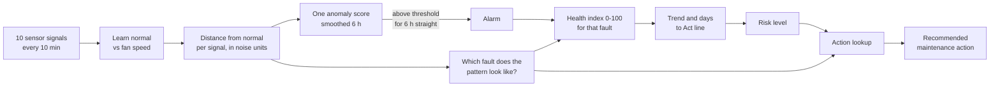

# Predictive-maintenance logic: from sensor readings to a maintenance action

This document explains *why* each step exists, what the numbers mean, and how a raw reading turns into
"replace the bearing within 2 weeks". The code for each step is named in brackets. All figures come from the
bundled bearing-wear scenario (seed 7), so you can reproduce them with `streamlit run app.py`.

The design principle: **every output can be traced back to a signal that moved**. Nothing is a black box, so a
technician can see *why* the system says "bearing" and check it.

---

## 1. What the machine is and what the sensors tell us

The asset is a belt-driven centrifugal supply fan with a 7.5 kW motor on a variable-frequency drive (VFD).
A failing component changes how the machine vibrates, sounds, heats up and draws power, in a different way for
each component. That is what makes diagnosis possible.

| Signal | Physical meaning | Rises or falls when... |
| --- | --- | --- |
| Vibration overall (mm/s) | Total shaking energy | Almost any mechanical fault, but late and non-specific |
| Vibration at 1x shaft speed | Shaking once per shaft turn | **Imbalance** (a heavy spot on the impeller pulls the shaft once per turn) |
| Vibration high-frequency (g) | Fine, sharp impacts | **Bearing wear** (rolling elements hitting damaged surfaces); the earliest bearing sign |
| Sound level (dB) | Overall noise | Mostly follows fan speed; weak fault indicator |
| Sound high-frequency band | Squeal, grinding | **Bearing wear** (grinding) and **belt slip** (squeal) |
| Bearing temperature rise | Friction heat | **Bearing wear** (rises, slowly, with a thermal lag) |
| Winding temperature rise | Motor heating | Falls slightly with a **clogged filter** (less airflow, less load) |
| Motor current (A) | Electrical load | **Clogged filter** (less airflow, so less load: current falls) |
| Power (kW) | Electrical load | **Clogged filter** (falls); **belt slip** (falls slightly) |
| Current ripple (%) | Variation in motor current | **Belt slip** (the load pulses as the belt slips and grips) |

Two details matter for interpretation:

- **Temperatures are used as "rise over ambient"**, because a hot afternoon is not a fault.
- **Different faults move different signals, in different directions.** A clogged filter makes power go *down*;
  a bearing fault makes vibration go *up*. No single sensor tells the story, which is why the logic combines them.

## 2. Step 1: learn what "normal" looks like [`analytics.fit_baseline`]

A fan at 55% speed and at 100% speed behave very differently (power rises roughly with the *cube* of speed).
If we compared today's reading with a single average, every change of speed would look like a fault.

So for each signal we learn **its normal value as a function of fan speed**, using a cubic curve fitted to the
first 14 days, assumed healthy. We also learn the signal's **normal noise level** (a robust spread measure, the
median absolute deviation) so we know how much wobble is ordinary.

> Result: at any moment we can say "at the current speed, vibration should be about 1.3 mm/s, give or take its normal noise".

## 3. Step 2: measure the distance from normal [`analytics.z_scores`]

For every signal, `z = (actual - expected at this speed) / normal noise`. It is "how many noise units away from
normal is this signal?". Values around 0 are normal. Beyond about 3 is unusual. This puts all ten signals, with
different units and scales, onto one comparable scale.

The dashboard's "Signals furthest from normal" chart is exactly this, on a log axis.

## 4. Step 3: one anomaly score, and a rule for when to raise it [`analytics.smooth`, `anomaly_score`, `sustained_flag`]

1. **Smooth** each z-score over about 6 hours (an exponentially weighted average) so single noisy readings and
   the day/night swing do not trigger anything.
2. **Combine** the ten smoothed z-scores into one number, their root-mean-square: "how far from normal overall".
3. **Threshold**: learned from the healthy period as 1.6 times the highest score seen while healthy (1.67 in the
   example). The system raises no alarm on data it knows is healthy.
4. **Persistence rule**: the alarm turns on only after the score stays above the threshold for **6 hours in a
   row**, and turns off only after it falls well below (below 0.6 times the threshold) for 6 hours. This stops
   the alarm flickering and suppresses one-off spikes.

Bearing example: the score is 0.43 at day 25 (normal) and the alarm starts at day 38.8, about 9 days after the
fault began at day 30 and 17 days before the simulated failure.

## 5. Step 4: diagnose, which fault does this look like? [`analytics.diagnose`]

Each known fault has a **fingerprint**: which signals it moves, in which direction, and by how much relative to
the others (`config.SIGNATURES`):

| Fault | Fingerprint (signal: weight) | Why |
| --- | --- | --- |
| Bearing wear | high-freq vibration 1.0, high-freq sound 0.8, bearing temp 0.7, overall vibration 0.6 | Impacts, grinding noise, friction heat |
| Fan imbalance | vibration at 1x 1.0, overall vibration 0.7 | A heavy spot shakes the shaft once per turn |
| Belt slip / looseness | current ripple 1.0, high-freq sound 0.6, power -0.2 | Pulsing load, squeal, slightly less power transmitted |
| Clogged filter | power -1.0, current -0.9, winding temp -0.3 | Less airflow, so the motor does less work |

The system compares the **pattern of z-scores right now** with each fingerprint using **cosine similarity**
(1 means the same shape, 0 means unrelated). The best match wins. Two details make it trustworthy:

- **Confidence** is the winner's share of the (squared) similarity across all faults, shown as the donut.
- **"Unclassified anomaly"**: if even the best match is below 0.55, the system does *not* force a label. It
  reports an abnormal but unrecognised pattern and recommends an inspection.

The evidence list ("vibration high-freq +13, bearing temp +4...") shows which signals support the diagnosis.

## 6. Step 5: health index, how far along the failure path? [`analytics.health_index`]

The index runs from 100 (normal) to 0 (the diagnosed fault has reached its failure level).

`severity = (fingerprint weights . current z-scores) / (fingerprint weights . z-scores at failure)`

`health = 100 x (1 - severity)`, averaged over the last 24 hours so the day/night swing does not dominate.

Bands: **Healthy 70-100, Watch 40-70, Act below 40.**

Worked example, bearing at day 42: the weighted evidence is 1.0 x 13.3 + 0.8 x 3.2 + 0.7 x 3.8 + 0.6 x 2.4 = 20.0.
At failure the same sum is about 212 (high-frequency vibration reaches 140 noise units, and so on). So the fault is
about 9% of the way to failure and health is about 91. At day 52 the evidence is about 84, 34, 22 and 11 and health
is 42.

The "failure level" values (`config.FAIL_Z`) are calibrated on the simulator. In a real plant they would come from
alarm limits in standards (for example ISO 10816 vibration zones), manufacturer limits, or past failures.

## 7. Step 6: how long is left? [`analytics.remaining_useful_life`]

Wear usually accelerates, so a straight line through the health values would be too optimistic. The system fits an
**accelerating curve** to the loss of health since the alarm started, `loss = c x (t - t0)^p`, where `p` above 1 means
"speeding up", and `t0` is when degradation really began (up to 12 days before the alarm). It tries a grid of `t0` and
`p`, keeps the best fit, and extrapolates to the Act line (health 40).

The **range** shown ("11 to 14 days") comes from every fit that is nearly as good as the best one. A narrow range means
the data pins the trend down. A wide range means it does not, which is honest uncertainty rather than a made-up
single number. The system refuses to forecast until it has at least 2 days of flagged data
("Not enough flagged history yet"), and when the trend is not clear it says "No clear downward trend".

## 8. Step 7: risk and recommended action [`analytics.risk_level`, `recommend`]

| Condition | Risk |
| --- | --- |
| Not flagged, health above 40 | Low |
| Flagged, trend unclear | Medium |
| Days to Act more than 14 | Low |
| Days to Act 3 to 14 | Medium |
| Days to Act under 3, or health already below 40 | High |

The action is then looked up from **(fault, risk)** (`config.ACTIONS`). Examples for bearing wear:

| Risk | Action |
| --- | --- |
| Low | Increase vibration and temperature monitoring; plan bearing inspection at next shutdown |
| Medium | Schedule bearing replacement within 2 weeks; order spare bearing and book a technician |
| High | Replace the fan bearing now; run at reduced speed until done to avoid seizure |

The other three faults and the "unclassified" case have their own three-level tables. Because the action depends on
both *what* is wrong and *how urgent* it is, the same fault produces different instructions as it progresses.

## 9. Worked example: one bearing failure, end to end

| | Day 25 | Day 38.8 | Day 42 | Day 52 |
| --- | --- | --- | --- | --- |
| Situation | Normal | Alarm starts | Early warning | Near failure |
| Anomaly score (threshold 1.67) | 0.43 | 2.12 | 4.57 | 29.7 |
| High-freq vibration, noise units | within normal | +6 | +13 | +84 |
| Overall vibration, noise units | within normal | +1 | +2.4 | +34 |
| Diagnosis | none | Bearing wear | Bearing wear, 97% | Bearing wear, 94% |
| Health index | 99 | 97 | 91 | 42 |
| Days to Act line | n/a | not enough history | 11 (range 11 to 14) | about 0 |
| Risk | Low | Medium | Medium | High |
| Action | Routine monitoring | Schedule bearing replacement within 2 weeks | Same (about 11 days left) | Replace now; reduce speed |

The key point of the example is **day 42**. Overall vibration, the signal a basic monitor would watch, is only 2.4 noise
units out, which is still inside normal limits. High-frequency vibration, bearing temperature and high-frequency sound
have already moved together in the pattern a failing bearing produces. Combining signals, conditioning on speed and
requiring persistence is what gives the early, specific warning, about 2 weeks before the simulated failure at day 56.

## 10. Why rule-based, and how it would change on real data

**Why this approach for a proof of concept.** It is explainable (each output traces to named signals), needs no
failure history to train on, and every threshold has a physical or statistical reason.

**Known weaknesses (also in the README).**
- Data is simulated by the same author as the analytics, so results flatter the method.
- Failure levels and the trend model were tuned on the simulator.
- Imbalance days-remaining is about 30% pessimistic and the clogged-filter forecast is noisy.
- One fault at a time; no sensor faults (dropouts, drift, miscalibration).

**What changes with real data.**
1. Replay logged data through the same pipeline; the baseline learns each machine's own normal.
2. Replace hand-set failure levels with alarm limits or levels from past failures.
3. Learn fingerprints from labelled maintenance records instead of fixed weights.
4. Add sensor-health checks so a dead sensor is not read as a fault.
5. Keep this pipeline as the explainable baseline, and compare a learned model against it (for example an isolation
   forest for detection, or a regression model for remaining useful life).
